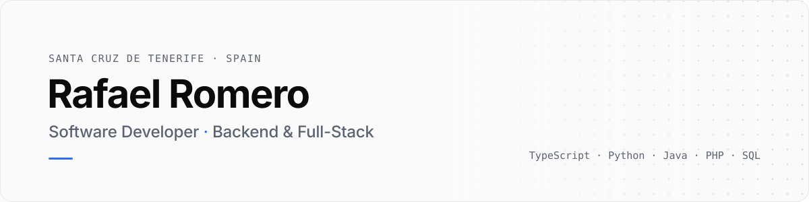

<picture>
  <source media="(prefers-color-scheme: dark)" srcset="assets/banner-dark.svg">
  <source media="(prefers-color-scheme: light)" srcset="assets/banner-light.svg">
  
</picture>

 

I'm Rafael, a software developer in Tenerife. I build web applications and internal tools, and I enjoy the parts that are easy to get wrong: data models, business rules, and software that keeps working once real people depend on it every day.

### Professional Summary

- About two years building websites and web applications for client businesses, covering frontend, backend, databases, servers and third-party integrations.
- Designed, built and maintain an NFC attendance system that a non-profit food bank uses every day. I rewrote it after a data audit showed that 27 % of the logged visits were duplicates.
- I write tests as part of the work, not after it: pytest, Vitest, Playwright end-to-end tests, and database security tests against a real PostgreSQL.
- I came to software from field engineering in renewable energy, which taught me to treat production systems carefully.
- Looking for **Software Developer, Backend or Full-Stack** roles at product companies, in Spain or remote.

### Technical Expertise

| | Daily work and projects | Also worked with |
|---|---|---|
| **Languages** | TypeScript, JavaScript, Python, PHP, SQL | Java |
| **Frontend** | React, Next.js, HTML5, CSS3, Tailwind CSS | |
| **Backend** | Node.js, REST APIs, Next.js Server Actions | Spring Boot |
| **Data** | PostgreSQL, Supabase (RLS, Auth, Storage), SQLite, MySQL | Oracle, Firebase |
| **Desktop & hardware** | PySide6 / PyQt5, NFC readers (PC/SC) | Electron |
| **Testing** | pytest, Vitest, Playwright | |
| **Tools & infra** | Git, GitHub Actions, Docker, Linux, WordPress (custom plugins), server administration | |

### Featured Projects

**[Sonrisas NFC](https://github.com/rafaromerodev/sonrisas-nfc)** 
A desktop app that replaced paper records with NFC cards at a non-profit food bank, in daily use since 2025. Version 2 was rewritten from a production data audit: one visit per person per day, card replacement that keeps the history, expiry warnings, soft deletes, layered architecture and 115 tests. 
Python · PySide6 · SQLite · NFC (PC/SC) · pytest

**[Smart Household Dashboard](https://github.com/rafaromerodev/smart-household-dashboard)** 
A shared PWA for two people covering groceries, meal plans, expenses, budgets, savings, workouts and chores. Authorization is enforced in PostgreSQL with Row Level Security and checked by integration tests. Business logic is pure and unit tested, money is stored as integer cents, and a real-time shopping list keeps both people in sync. 
Next.js 15 · TypeScript · Supabase · PostgreSQL · Vitest · Playwright

### Professional Experience

**Web Developer**, Tu Idea Digital, Tenerife · *2025 – present* 
Websites and web applications for client businesses: frontend, backend, databases, hosting and server setup, and third-party service integrations.

**Software Developer (independent)**, ONG Sonrisas Canarias · *2025 – present* 
Built and maintain the NFC beneficiary and attendance system, migrated the production data from v1 to v2, and redesigned [the organisation's website](https://ongsonrisascanarias.es).

**Before software:** wind turbine maintenance technician (Enercon, 2020), photovoltaic engineering internship (2019), and store and purchasing management in retail (2017–2025).

**Education:** Higher Technician in Multiplatform Application Development (DAM) · Higher Technician in Renewable Energy. 
**Languages:** Spanish (native) · English (advanced) · French (intermediate).

### Contact & Links

